<!-- _class: lead -->
<!-- _paginate: false -->
<!-- _footer: "" -->

# Aprendizado de Máquina via Algoritmo Random Forest

## Estudo de caso: redes sociais derrubam a nossa produtividade?

*Disciplina: Inteligência Artificial*
*Integrantes: [nomes do grupo]*

<!--
Hoje vamos mostrar como uma máquina aprende com dados usando um algoritmo chamado Random Forest. E vamos usar uma pergunta que todo mundo aqui já se fez: será que o tempo nas redes sociais está acabando com a nossa produtividade?
-->

---

<!-- _class: secao -->

# 1. Introdução à Inteligência Artificial

---

# O que é Inteligência Artificial?

* Área da computação que cria sistemas capazes de realizar tarefas que **normalmente exigiriam inteligência humana**
* **Reconhecer:** rostos, voz, objetos
* **Entender:** textos e perguntas
* **Decidir:** rotas, recomendações
* **Prever:** clima, demanda, comportamento

> Você usa IA várias vezes por dia: o feed da sua rede social é organizado por uma.

<!--
IA não é só robô de filme. É qualquer sistema que faz algo que pareceria exigir inteligência. E a ironia: o próprio feed das redes sociais que vamos estudar é montado por uma IA.
-->

---

# Uma linha do tempo rápida

* **1950:** Alan Turing pergunta *"As máquinas podem pensar?"*
* **1956:** o termo *Inteligência Artificial* é cunhado na conferência de Dartmouth
* **Anos 1980–90:** sistemas especialistas (regras escritas à mão) e o crescimento do Machine Learning
* **2001:** Leo Breiman publica o **Random Forest**, o algoritmo de hoje
* **Hoje:** assistentes de IA, carros autônomos, diagnóstico por imagem

<!--
A ideia é antiga. O que mudou foi a quantidade de dados e de poder computacional. O Random Forest tem mais de 20 anos e continua sendo um dos algoritmos mais usados em dados tabulares.
-->

---

# Onde entra o Machine Learning?

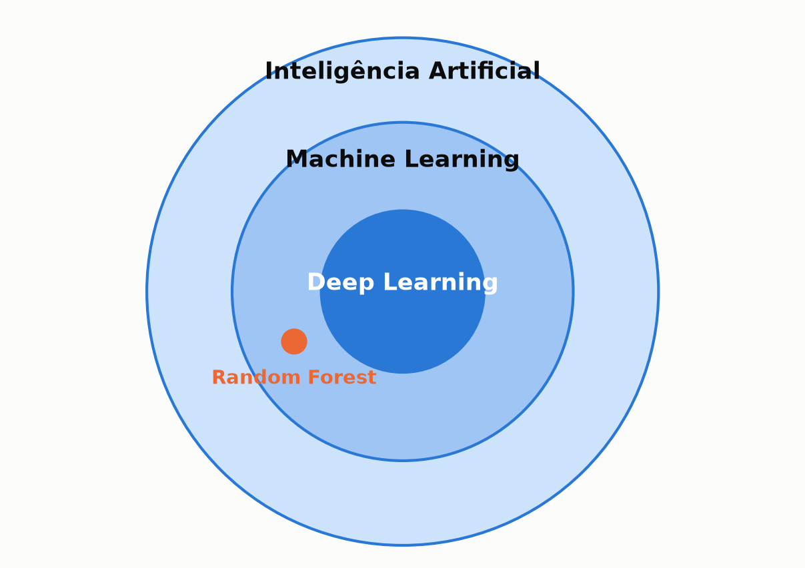

<!--
Machine Learning é uma subárea da IA: em vez de um programador escrever todas as regras, a máquina descobre as regras olhando exemplos. Deep Learning é uma parte do ML, com redes neurais. O Random Forest é um algoritmo clássico de Machine Learning, não de Deep Learning.
-->

---

<!-- _class: secao -->

# 2. Mergulho em Machine Learning

## Como as máquinas aprendem com dados

---

# Programar vs ensinar

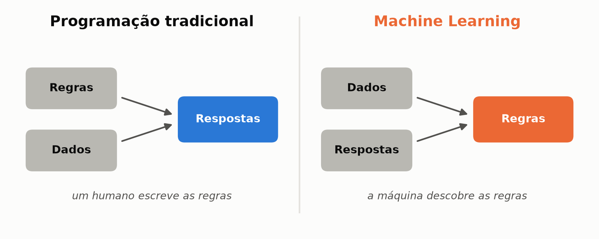

* Tradicional: *"SE usa mais de 5 h de redes, ENTÃO é pouco produtivo"*
* ML: *"Aqui estão 22 mil pessoas e a produtividade de cada uma. Descubra o que importa."*

<!--
Essa é a virada de chave: no Machine Learning invertemos o processo. Guardem o exemplo da esquerda: no final vamos ver se a regra que a gente "acha" verdadeira sobrevive aos dados.
-->

---

# Features e alvo

| Idade | Redes sociais | Notificações | Sono | Satisfação | ... | **Produtividade** |
|---|---|---|---|---|---|---|
| 32 | 4,0 h | 60 | 7 h | 6 | ... | **5,8** |
| 45 | 1,5 h | 52 | 6 h | 3 | ... | **3,1** |
| 27 | 6,2 h | 71 | 8 h | 8 | ... | **7,4** |

* **Features:** o que sabemos sobre cada pessoa
* **Alvo:** o que queremos prever
* O algoritmo procura **padrões** que ligam as features ao alvo em milhares de exemplos

<!--
Cada linha é uma pessoa, um exemplo. As características são as features; o que queremos prever é o alvo. Com milhares de exemplos o algoritmo encontra padrões que se repetem.
-->

---

# Que tipo de pergunta estamos fazendo?

## Aprendizado supervisionado: temos as respostas certas para aprender

* **Classificação:** prever uma categoria. *"Esse e-mail é spam ou não?"*
* **Regressão:** prever um número. *"Qual a produtividade desta pessoa, de 0 a 10?"*
* **Nosso caso: regressão.** O alvo é um número contínuo; dividir em "baixa / média / alta" jogaria informação fora

<!--
Se dividíssemos em faixas, uma pessoa com 4,9 e outra com 5,1 cairiam em classes diferentes, enquanto 3,4 e 4,9 ficariam juntas. Não faz sentido.
-->

---

# Treino e teste: a prova com questões inéditas

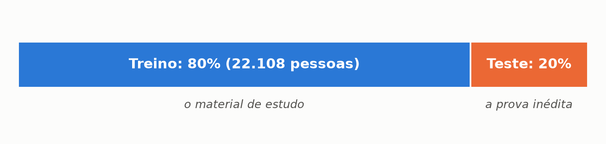

* O modelo estuda só o treino e é avaliado em pessoas que **nunca viu**
* **Overfitting = decorar a matéria:** tira 10 nos exercícios e vai mal na prova

<!--
O jeito honesto de avaliar um modelo é como uma prova com perguntas inéditas. Um modelo que só decorou o treino é inútil. Esse "decorar" é o vilão do próximo bloco.
-->

---

<!-- _class: secao -->

# 3. Random Forest, passo a passo

## Da árvore única à floresta

---

# Peça 1: uma Árvore de Decisão

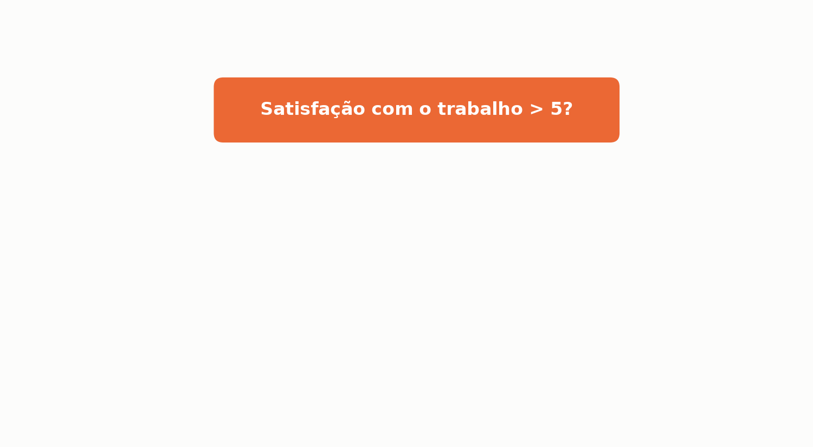

<!--
Uma árvore de decisão é um jogo de perguntas de sim ou não. Começa com uma pergunta...
-->

---

# Peça 1: uma Árvore de Decisão

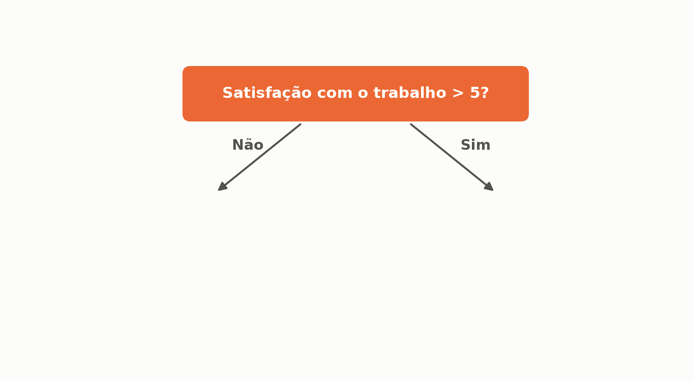

<!--
...que divide as pessoas em dois grupos...
-->

---

# Peça 1: uma Árvore de Decisão

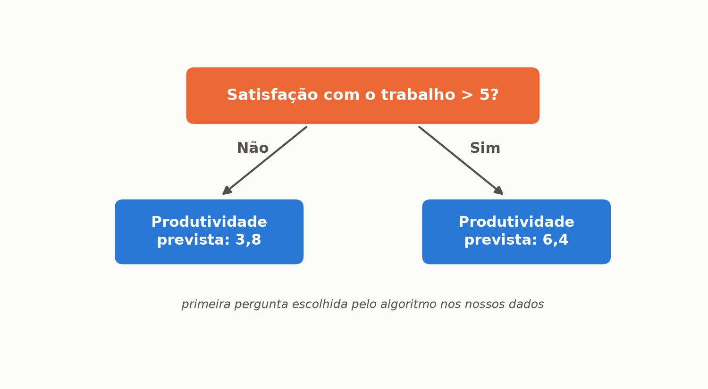

<!--
...e cada grupo recebe uma previsão: a média do grupo. Esta árvore não é inventada: com os nossos dados, a primeira pergunta que o algoritmo escolhe sozinho é exatamente essa, com esses valores.
-->

---

# A árvore cresce...

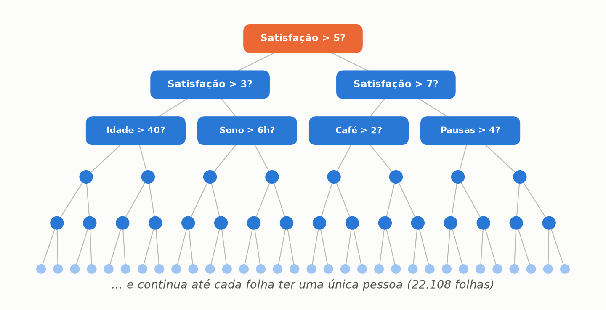

<!--
O algoritmo escolhe sozinho a pergunta que mais reduz o erro em cada passo. E continua perguntando até cada folha ter uma única pessoa: 22.108 folhas no nosso treino.
-->

---

# Peça 2: o problema da árvore única

<!-- _class: destaque -->

* R² no treino: **1,00**. *Acertou 100% do que estudou.*
* R² em dados novos: **0,41**. *Foi mal na prova.*
* Uma árvore sozinha **decora**, e é instável: mudar poucos dados muda a árvore inteira

<!--
Aqui está o overfitting na prática, com os nossos dados. Cada folha aprendeu o ruído de uma pessoa específica, e isso não se repete em pessoas novas.
-->

---

# A ideia: sabedoria das multidões

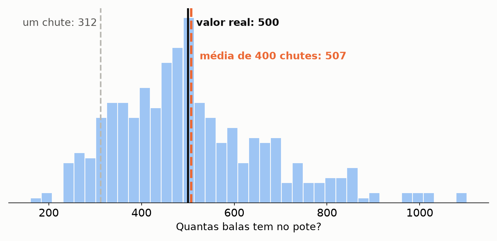

* Um chute individual erra feio; **a média de centenas de chutes chega perto do valor real**
* E se, em vez de uma árvore, usarmos **centenas**?

<!--
Os erros para cima e para baixo se cancelam. Mas atenção à palavra "independentes": se todas as árvores forem iguais, todas erram igual. Os próximos dois slides mostram como o Random Forest cria árvores diferentes.
-->

---

# Ingrediente 1: cada árvore estuda uma amostra diferente

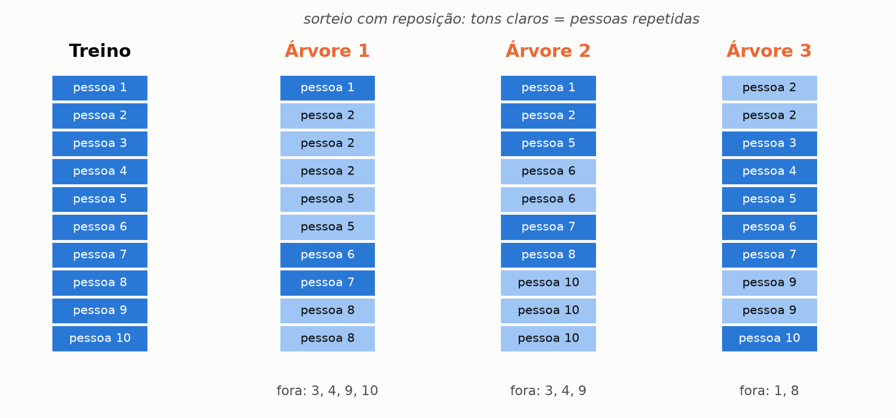

* **Bootstrap:** sorteio de linhas *com reposição*. Algumas pessoas se repetem, outras ficam de fora
* Os ~37% que ficam de fora viram uma **prova surpresa gratuita** (*out-of-bag*)

<!--
Cada árvore treina com uma versão levemente diferente dos dados. Isso se chama bootstrap, e a técnica de combinar essas árvores se chama bagging. As pessoas que ficaram de fora servem para testar aquela árvore sem gastar o conjunto de teste.
-->

---

# Ingrediente 2: cada pergunta vê só parte das variáveis

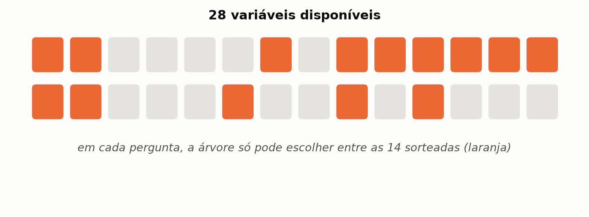

* Em cada pergunta, um **novo sorteio** de variáveis (no projeto: 50% delas)
* Árvores **diferentes entre si** erram de jeitos diferentes. É o **"Random"** do nome

<!--
Sortear as variáveis impede que todas as árvores façam exatamente as mesmas perguntas.
-->

---

# A floresta: o consenso

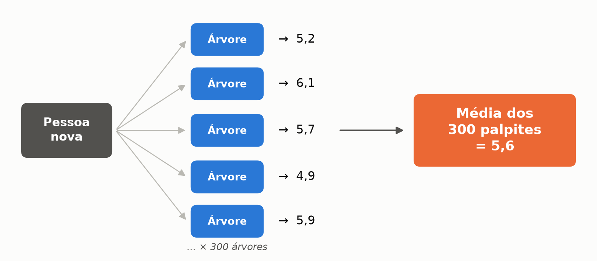

* Cada uma das **300 árvores** dá um palpite; a previsão final é a **média**

<!--
Esse é o Random Forest: muitas árvores diferentes, cada uma com seus erros, e o consenso entre elas.
-->

---

# Árvore única vs floresta

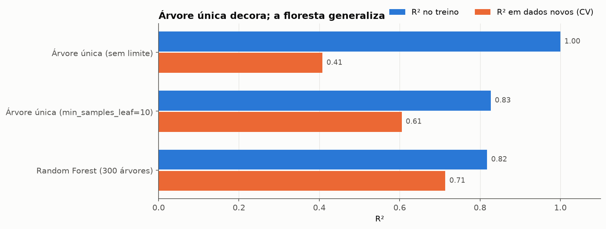

* Com os mesmos dados, o acerto em pessoas novas foi de **0,41 para 0,71**

<!--
Laranja é o que importa: o desempenho em dados novos. A árvore regularizada melhora, mas a floresta vai além.
-->

---

# Quantas árvores são suficientes?

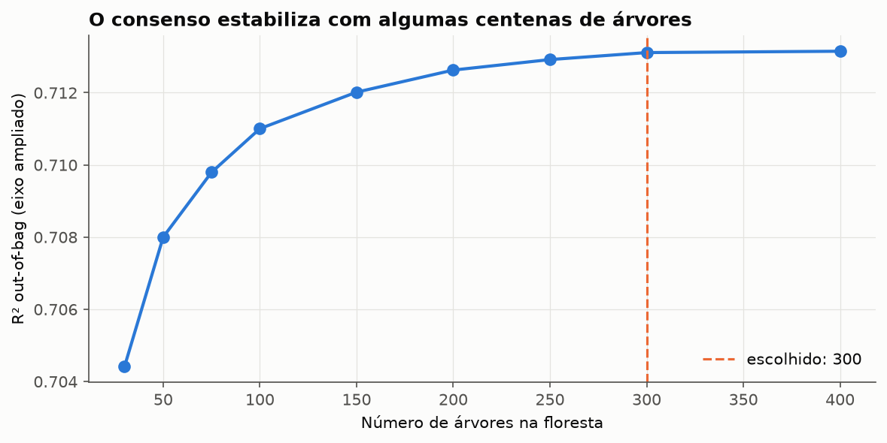

* Sobe rápido até ~100 e **estabiliza** a partir de ~250 (eixo vertical ampliado)
* Escolhemos **300 árvores**, 50% das variáveis por pergunta e mínimo de 10 pessoas por folha

<!--
Uma propriedade bonita: adicionar árvores não causa overfitting, o resultado só estabiliza. Escolhemos 300, já no platô.
-->

---

<!-- _class: secao -->

# 4. O Projeto

## Redes Sociais vs Produtividade

---

<!-- _class: destaque -->

# Redes sociais derrubam a nossa produtividade?

* O senso comum diz que **sim**
* Vamos perguntar aos dados e deixar o **Random Forest** decidir o que importa

---

# O dataset

* **30.000 pessoas** e **19 informações** sobre cada uma
* **Perfil:** idade, gênero, área de atuação
* **Hábitos digitais:** horas em redes sociais, rede favorita (TikTok, Instagram, Facebook, Twitter, Telegram), notificações, tela antes de dormir
* **Rotina e bem-estar:** horas de trabalho, pausas, café, sono, estresse, burnout, satisfação com o trabalho
* **Alvo:** produtividade real, de 0 a 10

<!--
O dataset Social Media vs Productivity tem 30 mil pessoas com hábitos digitais, rotina, bem-estar e a produtividade medida de cada uma.
-->

---

# O pipeline

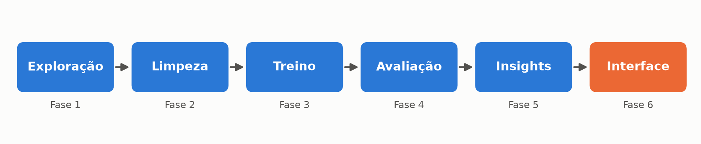

* Cada fase está em um **notebook separado** no repositório
* Antes de treinar: tratamento de **valores nulos** e conversão de categorias em números

---

# Primeira descoberta: a ilusão de produtividade

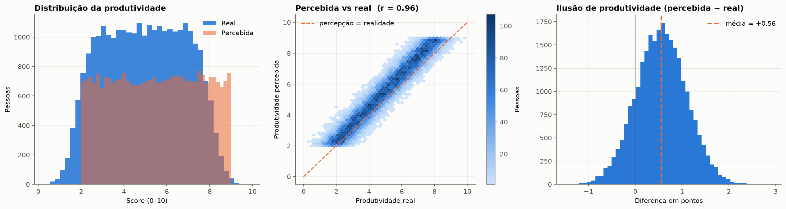

* **85% das pessoas se acham mais produtivas do que são**, em média +0,56 ponto
* Por isso **não usamos** a produtividade percebida como entrada: seria prever a resposta usando a própria resposta (*data leakage*)

<!--
A exploração já mostrou um comportamento humano interessante: a gente se superestima. E isso trouxe uma decisão: tiramos essa coluna, porque ela é praticamente a resposta disfarçada.
-->

---

# O modelo funciona?

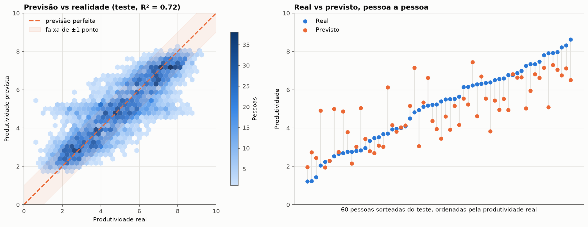

* **R² = 0,72** · **erro médio = 0,78 ponto** · **72%** das previsões a até 1 ponto do real
* Testado em **5.527 pessoas** que o modelo nunca viu (chutar a média erraria 1,6 ponto)

<!--
O modelo explica cerca de 72% da variação da produtividade em pessoas novas. Mas a pergunta que interessa: o que ele aprendeu?
-->

---

<!-- _class: secao -->

# 5. Descobertas

## O que o Random Forest aprendeu

---

# O que o modelo usa para prever?

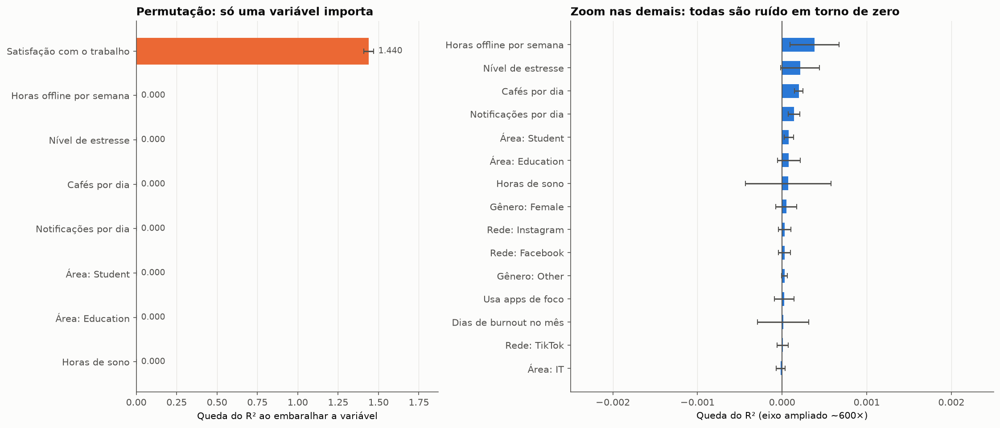

* *"Se eu embaralhar esta informação, o modelo piora quanto?"*
* Entre 28 variáveis, encontrou **sozinho** a única que importa: **satisfação com o trabalho**

<!--
Embaralhar a satisfação destrói o modelo. Embaralhar qualquer outra coisa, inclusive as redes sociais, não muda nada. Observe o zoom à direita: o eixo está ampliado cerca de 600 vezes, e mesmo assim tudo fica em volta de zero.
-->

---

# E as redes sociais?

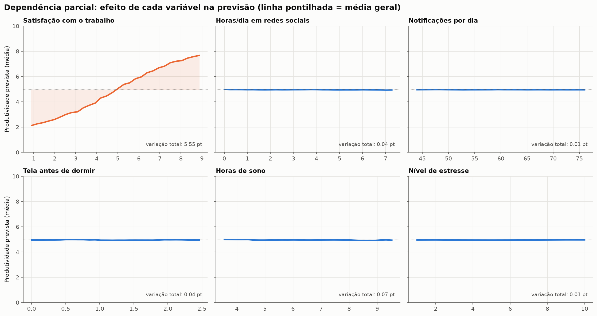

* De 0 a 7 h/dia de redes: a previsão muda **0,04 ponto**. Satisfação: **5,5 pontos**

<!--
Este gráfico mostra como a previsão muda quando só uma variável muda. Redes sociais: reta. Notificações: reta. Sono e estresse: retas. A única curva que se mexe é a satisfação com o trabalho.
-->

---

# Simulação: "e se...?"

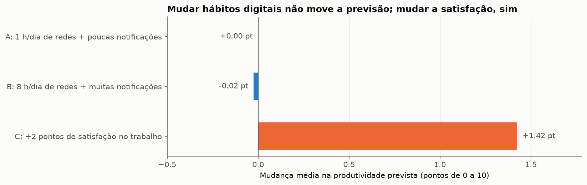

* *E se todos usassem só 1 h/dia?* → **0,00 ponto**
* *E se todos usassem 8 h/dia, com muitas notificações?* → **−0,02 ponto**
* *E se a satisfação de todos subisse 2 pontos?* → **+1,42 ponto**

<!--
Pedimos ao modelo para imaginar mundos diferentes, aplicados às 5.527 pessoas do teste. A rede favorita também não importa: entre TikTok e Facebook a diferença é de 0,02 ponto.
-->

---

# Plot twist: a Feature Importance pode mentir

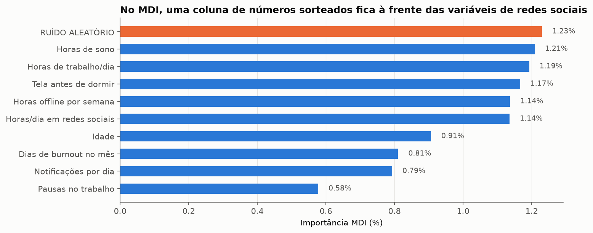

* Adicionamos uma coluna de **números sorteados ao acaso**, e ela ficou em **2º lugar**, à frente das redes sociais
* A importância padrão (MDI) premia até ruído. Para concluir algo, use **permutação nos dados de teste**

<!--
A importância que o Random Forest calcula por padrão dava cerca de 1% para as redes sociais. Mas números aleatórios ficaram na frente delas. Aquele 1% não era sinal, era o modelo se ajustando a ruído.
-->

---

# Um modelo simples empata

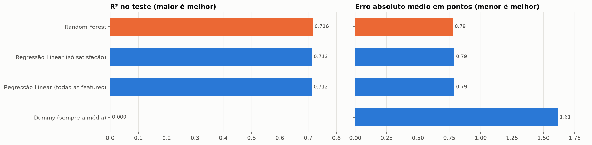

* Regressão linear usando **só a satisfação**: R² 0,713 · Random Forest com 28 variáveis: R² 0,716
* Não havia padrões complexos escondidos: **o sinal estava em uma única variável**

<!--
Sempre comparem com um modelo simples. Isso não é fracasso do Random Forest: ele chegou ao melhor resultado possível com esses dados e ainda nos mostrou onde estava o sinal.
-->

---

# Então redes sociais não fazem mal?

* **Dados sintéticos:** as variáveis não têm relação nenhuma entre si (nem sono com estresse), algo improvável na vida real
* **Correlação não é causalidade:** o modelo aprende associações, não causas
* **A pesquisa real é mais nuançada:** efeitos negativos aparecem mais ligados a **interrupções** e **uso compulsivo** do que ao tempo total de tela

> A conclusão vale para **estes dados**, não necessariamente para a vida de vocês.

<!--
Precisamos ser honestos: o modelo aprendeu corretamente as regras deste dataset, mas este dataset não representa bem o mundo real.
-->

---

# O que aprendemos sobre Machine Learning

1) O modelo **só aprende o que está nos dados**
2) Sempre compare com um **baseline simples**
3) Desconfie da Feature Importance padrão; use **permutação**
4) Um resultado "nulo" **também é um resultado**

<!--
Se fosse para levar só quatro coisas desta apresentação, seriam essas.
-->

---

<!-- _class: secao -->

# 6. Agora é com vocês

---

<!-- _class: destaque -->

# Qual seria a SUA produtividade?

* O projeto conta com uma **interface interativa** feita com Gradio
* Sliders e menus para os seus hábitos; o modelo treinado responde **na hora**
* **Demonstração ao vivo**

<!--
Roteiro da demonstração:
1. Começar com um perfil médio e mostrar a previsão.
2. Arrastar o slider de redes sociais de 1 h para 10 h: a previsão praticamente não muda.
3. Trocar a rede favorita: nada muda.
4. Arrastar o slider de satisfação com o trabalho: a previsão sobe ou desce vários pontos.
5. Pedir a um voluntário que diga seus valores.
-->

---

<!-- _class: lead -->
<!-- _footer: "" -->

# Obrigado!

## Perguntas?

*Random Forest: muitas árvores diferentes, uma decisão melhor.*

Repositório: github.com/rodrigololr/ubiquitous-invention
