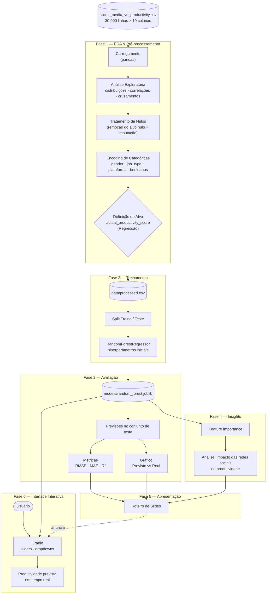

# Redes Sociais vs Produtividade — Aprendizado de Máquina com Random Forest

> Projeto acadêmico da disciplina Inteligência Artificial. TEMA: **"Aprendizado de Máquina via Algoritmo Random Forest"**.
> Investigamos como hábitos digitais (tempo em redes sociais, notificações, uso de celular antes de dormir etc.) se relacionam com a **produtividade real** das pessoas, e entregamos um modelo preditivo acessível por uma interface web interativa.

---

## Sumário

1. [Propósito do Projeto](#propósito-do-projeto)
2. [O Dataset](#o-dataset)
3. [Estrutura do Repositório](#estrutura-do-repositório)
4. [Pipeline de Dados](#pipeline-de-dados)
5. [Como Executar](#como-executar)
6. [Fases do Projeto](#fases-do-projeto)
7. [Autores](#autores)
8. [Tecnologias](#tecnologias)

---

## Propósito do Projeto

As redes sociais fazem parte da rotina de praticamente todos os profissionais, mas qual é o seu real impacto no desempenho do dia a dia? Este projeto busca responder, com dados, perguntas como:

- O tempo diário em redes sociais reduz a produtividade?
- Notificações, horas de sono e tela antes de dormir pesam mais do que a própria rede social?
- Ferramentas de foco e bem-estar digital fazem diferença?
- A produtividade **percebida** pelas pessoas corresponde à produtividade **real**?

Para isso, utilizamos o algoritmo **Random Forest** (scikit-learn), escolhido por:

- lidar bem com variáveis numéricas e categóricas misturadas;
- capturar relações **não lineares** e interações entre variáveis;
- ser robusto a *overfitting* (graças ao consenso entre muitas árvores);
- fornecer **Feature Importance**, essencial para extrair insights interpretáveis.

---

## O Dataset

Arquivo: [`social_media_vs_productivity.csv`](social_media_vs_productivity.csv) — **30.000 registros** e **19 colunas**.

| Grupo | Colunas |
|---|---|
| **Perfil** | `age`, `gender`, `job_type` |
| **Hábitos digitais** | `daily_social_media_time`, `social_platform_preference`, `number_of_notifications`, `screen_time_before_sleep`, `weekly_offline_hours` |
| **Rotina de trabalho** | `work_hours_per_day`, `breaks_during_work`, `coffee_consumption_per_day` |
| **Bem-estar** | `stress_level`, `sleep_hours`, `days_feeling_burnout_per_month`, `job_satisfaction_score` |
| **Ferramentas** | `uses_focus_apps`, `has_digital_wellbeing_enabled` |
| **Produtividade** | `perceived_productivity_score`, `actual_productivity_score` |

> **Variável alvo:** `actual_productivity_score` (contínua, escala 0–10), tratada como problema de **regressão**. A justificativa completa está na Fase 1. A coluna `perceived_productivity_score` é removida das variáveis de entrada para evitar *data leakage* (vazamento de informação do alvo).

O dataset contém **valores nulos** em algumas colunas numéricas, que são tratados no pré-processamento.

---

## Estrutura do Repositório

```
.
├── README.md                          # Este documento
├── pyproject.toml / uv.lock           # Dependências do projeto (gerenciadas pelo uv)
├── social_media_vs_productivity.csv   # Dataset bruto (fonte de dados)
│
├── 01_eda_preprocessing.ipynb         # Fase 1 — EDA + limpeza + encoding + definição do alvo
├── 02_model_training.ipynb            # Fase 2 — Split treino/teste + treino do Random Forest
├── 03_evaluation.ipynb                # Fase 3 — Métricas e gráficos de desempenho
├── 04_insights.ipynb                  # Fase 4 — Feature Importance + análise dos achados
├── 05_slides.md                       # Fase 5 — Slides da apresentação (Marp)
├── 05_presentation_script.md          # Fase 5 — Roteiro detalhado com as falas de cada slide
├── 06_app.py                          # Fase 6 — Interface interativa com Gradio
│
├── data/                              # (gerado) Dados processados pela Fase 1
├── models/                            # (gerado) Modelo treinado serializado (joblib)
├── figures/                           # (gerado) Gráficos exportados para os slides
└── slides/                            # Diagramas didáticos dos slides (diagramas.py gera slides/img/)
```

| Arquivo | O que faz |
|---|---|
| `01_eda_preprocessing.ipynb` | Carrega o CSV, explora distribuições, correlações e cruzamentos entre variáveis comportamentais; trata nulos, codifica variáveis categóricas e salva o dataset limpo em `data/`. |
| `02_model_training.ipynb` | Lê os dados processados, separa treino/teste, instancia e treina o `RandomForestRegressor` com hiperparâmetros iniciais e salva o modelo em `models/`. |
| `03_evaluation.ipynb` | Carrega o modelo, gera previsões no conjunto de teste e calcula métricas (RMSE, MAE, R²), com gráficos de desempenho. |
| `04_insights.ipynb` | Extrai e plota a *Feature Importance* e discute, em profundidade, o que o modelo revelou sobre redes sociais e produtividade. |
| `05_slides.md` | Apresentação em [Marp](https://marp.app/) com lógica "clique para aparecer": IA → ML → Random Forest → Projeto → Descobertas → Encerramento. As falas ficam nas notas do apresentador. |
| `05_presentation_script.md` | Roteiro detalhado de cada slide: o que aparece a cada clique, a fala sugerida, o checklist de figuras e as perguntas prováveis da plateia. |
| `slides/diagramas.py` | Gera os diagramas didáticos (árvore de decisão, bootstrap, consenso etc.) usados nos slides. |
| `06_app.py` | Aplicação Gradio que recebe os hábitos do usuário (sliders e dropdowns) e prevê sua produtividade em tempo real com o modelo treinado. |

> Os diretórios `data/`, `models/` e `figures/` são criados automaticamente durante a execução dos notebooks.

---

## Pipeline de Dados



---

## Como Executar

O projeto usa o **[uv](https://docs.astral.sh/uv/)** para gerenciar Python e dependências. O uv mantém um cache global compartilhado entre projetos (as bibliotecas são reaproveitadas via *hardlinks*), então não há cópias duplicadas de pacotes ocupando espaço em disco.

### 1. Pré-requisitos

- **uv** instalado:

```bash
curl -LsSf https://astral.sh/uv/install.sh | sh
```

O uv baixa automaticamente o Python 3.12 caso ele não esteja disponível.

### 2. Clonar o repositório

```bash
git clone git@github.com:rodrigololr/ubiquitous-invention.git
cd ubiquitous-invention
```

### 3. Instalar as dependências

```bash
uv sync
```

Esse comando lê o `pyproject.toml` e o `uv.lock` e instala exatamente as mesmas versões usadas no desenvolvimento.

### 4. Executar os notebooks **em ordem**

Cada fase depende dos artefatos gerados pela anterior:

```bash
uv run jupyter lab
```

1. `01_eda_preprocessing.ipynb` → gera `data/processed.csv` e gráficos em `figures/`
2. `02_model_training.ipynb` → gera `models/random_forest.joblib`
3. `03_evaluation.ipynb`
4. `04_insights.ipynb`

Em cada notebook, use **Kernel → Restart & Run All**. No VS Code, selecione o interpretador `.venv` criado pelo `uv sync` como kernel.

Para executar um notebook direto pelo terminal, sem abrir o Jupyter:

```bash
uv run jupyter nbconvert --to notebook --execute --inplace 01_eda_preprocessing.ipynb
```

### 5. Abrir a interface interativa

```bash
uv run python 06_app.py
```

Acesse o endereço exibido no terminal (por padrão `http://127.0.0.1:7860`). A interface também pode ser executada dentro de uma célula de notebook com `%run 06_app.py`.

### 6. Abrir e apresentar os slides

Os slides ficam em `05_slides.md` e usam o [Marp](https://marp.app/), que transforma Markdown em apresentação.

1. No VS Code, instale a extensão **Marp for VS Code** (`marp-team.marp-vscode`). O repositório já a recomenda ao ser aberto.
2. Abra `05_slides.md` e clique no ícone de pré-visualização (canto superior direito) para ver os slides.
3. Para **apresentar com os cliques**, exporte para HTML: `Ctrl+Shift+P` → **Marp: Export Slide Deck...** → formato **HTML**. Abra o arquivo no navegador e avance com as setas ou a barra de espaço. Os tópicos aparecem um por vez, e o modo apresentador (tecla `P` ou o ícone na barra inferior) mostra as falas.

> A pré-visualização do VS Code mostra todos os tópicos de uma vez: o efeito "clique para aparecer" funciona no HTML exportado. A exportação para **PDF** serve para entregar ou imprimir. Na exportação para **PPTX** os slides viram imagens, sem animações.

Pelo terminal (requer Node.js), sem o VS Code:

```bash
npx @marp-team/marp-cli 05_slides.md --allow-local-files -o apresentacao.html   # apresentação com cliques
npx @marp-team/marp-cli 05_slides.md --allow-local-files -o apresentacao.pdf    # PDF
```

Os diagramas didáticos são gerados com `uv run python slides/diagramas.py`.

---

## Fases do Projeto

| Fase | Entregável | Commit |
|---|---|---|
| 0 | `README.md` | `docs: adiciona README do projeto com diagrama do pipeline` |
| 1 | `01_eda_preprocessing.ipynb` | `feat: adiciona análise exploratória e pipeline de pré-processamento` |
| 2 | `02_model_training.ipynb` | `feat: implementa treinamento do Random Forest` |
| 3 | `03_evaluation.ipynb` | `feat: adiciona métricas e gráficos de avaliação do modelo` |
| 4 | `04_insights.ipynb` | `feat: extrai insights de importância das variáveis` |
| 5 | `05_slides.md` + `05_presentation_script.md` | `docs: adiciona roteiro dos slides da apresentação` |
| 6 | `06_app.py` | `feat: cria interface web interativa com Gradio` |

---

## Autores

| Aluno | Matrícula |
|---|---|
| Antônio Rodrigo Lima de Andrade Tenório | 23210707 |
| Bruno Gomes de Barros Filho | 21111360 |

---

## Tecnologias

| Biblioteca | Uso |
|---|---|
| `uv` | Gerenciamento de Python, ambiente e dependências |
| `pandas` / `numpy` | Manipulação e limpeza de dados |
| `matplotlib` / `seaborn` | Visualizações da EDA e da avaliação |
| `scikit-learn` | Random Forest, split, métricas |
| `joblib` | Persistência do modelo treinado |
| `gradio` | Interface web interativa |
| `jupyter` | Ambiente de desenvolvimento por fases |
